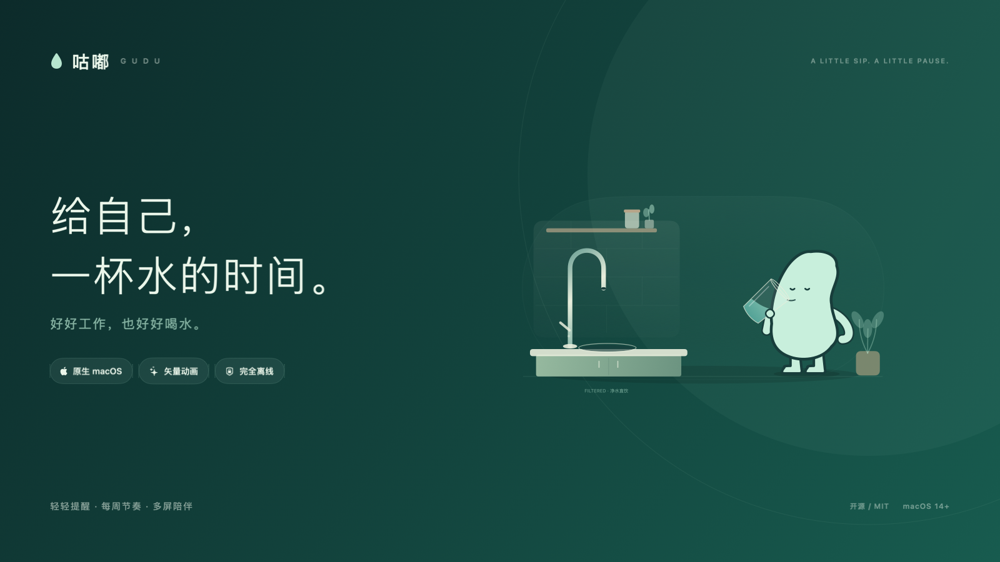
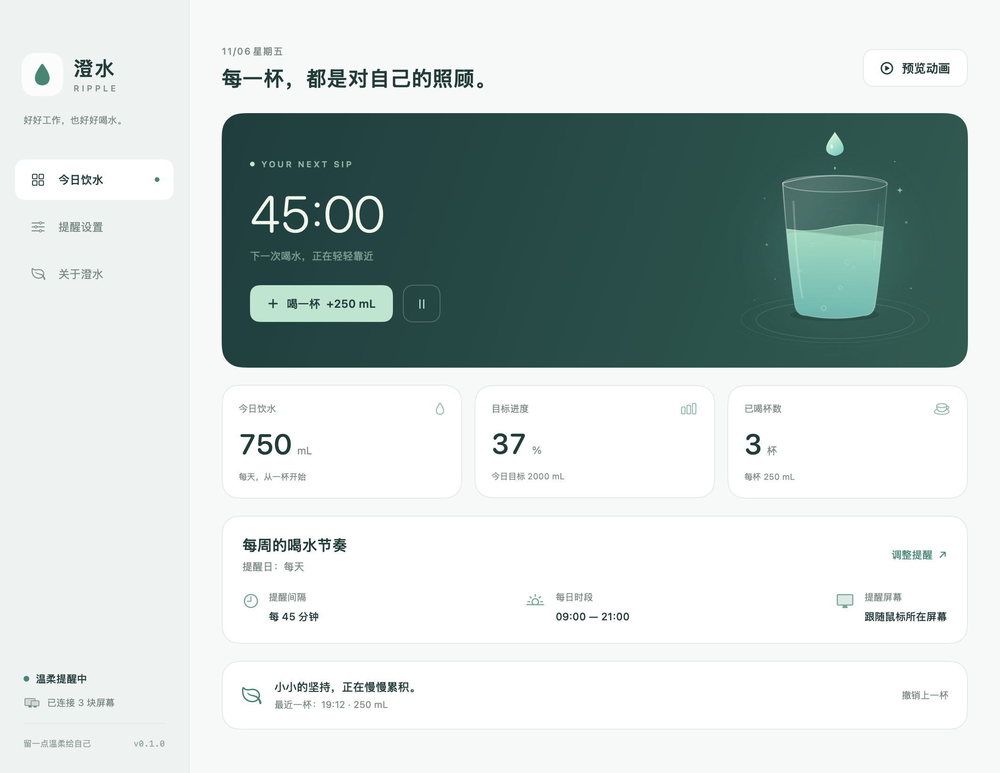
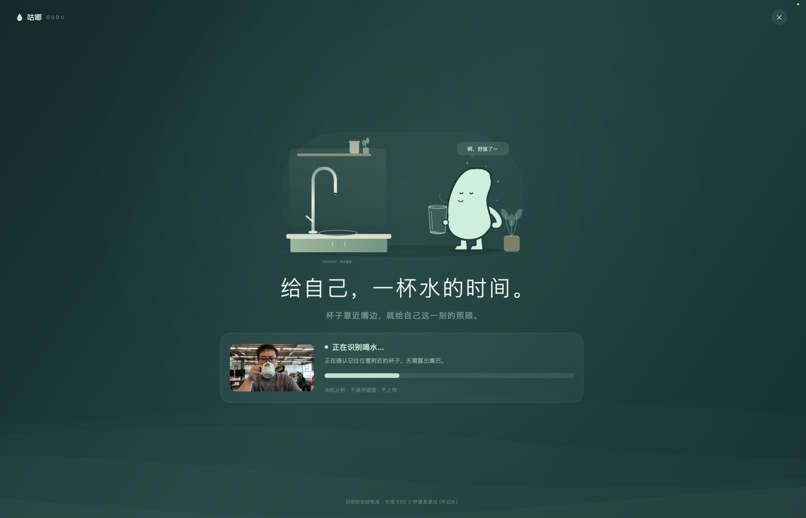

# Gudu · 咕嘟

**A small pause. A sip of water. A little care for yourself.**

A native macOS water reminder with configurable intervals, daily hours, a menu-bar companion, and a full-screen vector animation that follows the display under your pointer.

[简体中文](README.md) · [Development](docs/DEVELOPMENT.md) · [Architecture](docs/ARCHITECTURE.md) · [Contributing](CONTRIBUTING.md) · [MIT License](LICENSE)





## Download and install

**v0.1.0** requires **Apple Silicon (M-series) and macOS 14+**; prebuilt packages do not include Intel.

[Download unsigned arm64 build](https://github.com/xcoderliu/Gudu/releases/download/v0.1.0/Gudu-0.1.0-macos-arm64-unsigned.zip) · [SHA-256](https://github.com/xcoderliu/Gudu/releases/download/v0.1.0/Gudu-0.1.0-macos-arm64-unsigned.zip.sha256) · [Release notes](https://github.com/xcoderliu/Gudu/releases/tag/v0.1.0)

`unsigned.zip` is fully unsigned and unnotarized; Apple Silicon requires a local ad-hoc signature before it can run. Only the fully unsigned archive and its checksum are distributed in this release. See [installation details](docs/INSTALL.md) and [release preparation](docs/RELEASING.md). The legacy bundle identifier is retained to preserve existing preferences and drink history.

## Features

- Reminder intervals from 1 to 240 minutes, with quick presets.
- Daily start/end times, overnight schedules, and an all-day option when both times match.
- Select any weekdays, with Monday–Friday, weekend, and every-day presets. Selecting no days pauses automatic reminders.
- Resolution-independent SwiftUI Canvas animation: a calm dashboard glass and a full-screen open-kitchen ritual with a filtered-water tap, filling a cup, sipping, and a relieved exhale.
- One mint bean mascot with dot eyes and short limbs, drawn with simple vector paths. There are no gender or character options.
- Optional synchronized pouring, gulping, and sigh sound effects, synthesized offline. Multiple displays share one audio player.
- Pointer-display targeting, an explicit all-display mode, and an all-display fallback when no display matches the pointer.
- Drink confirmation, five-minute snooze, Escape to dismiss, and optional automatic dismissal.
- After completion, the fullscreen reminder closes before a three-second vector celebration on the same displays: wide confetti cannons and an overhead shower of paper, ribbons, and stars. The transparent overlay passes through mouse input and uses a static completion toast with Reduce Motion.
- Optional experimental camera verification: Apple Vision remembers the mouth position and checks nearby vessels even when the face is covered. Accumulating 3 seconds of weighted cup evidence completes a reminder; nearby hands can support weaker evidence at a slower rate, and missed detections pause progress without resetting it.
- Menu-bar access even after closing the dashboard.
- Daily intake, configurable serving size and goal, and undo for the most recent drink.
- Sleep, lock, and inactive sessions pause presentation while preserving the original deadline. Overdue reminders merge into one catch-up after a 30-second return buffer. If the next regular reminder is at most five minutes away on return, catch-up is skipped and that regular deadline is kept. Quiet hours and unselected days suppress catch-up; recording a drink or pausing cancels it.
- Keyboard access and a static vector scene when Reduce Motion is enabled.
- Offline operation, local preferences/history, no account or analytics, and optional launch at login.

The Lottie-style animation is implemented directly with SwiftUI vector paths and timelines. There are no third-party runtime dependencies. See [WaterScene.swift](Gudu/Animation/WaterScene.swift) and [DrinkingRitualScene.swift](Gudu/Animation/DrinkingRitualScene.swift). The original sound assets are generated with [make_sounds.py](scripts/make_sounds.py), with no recordings or downloaded samples.

## Build and run

Requires **macOS 14+ and Xcode 16+**. The current build has been checked on Apple Silicon with macOS 26.5.1 and Xcode 26.3. The user interface is currently in Simplified Chinese.

Open `Gudu.xcodeproj`, select **Gudu → My Mac**, and press **⌘R**. The checked-in project uses local ad-hoc signing, so a developer team is not required for local development.

```bash
./scripts/build.sh --run
./scripts/test.sh
```

The app is built at `build/Build/Products/Debug/Gudu.app`.

## Behavior

New installs default to **Monday–Friday, 09:00–18:30, every 45 minutes**, on the pointer display. Camera verification is on; sound and automatic dismissal are off. With the camera enabled, the dismissal picker shows “不自动关闭” and is disabled; disabling the camera restores the saved ordinary-mode choice. Serving size is 250 mL and the adjustable daily goal is 2000 mL. Login at startup is opt-in. Existing saved values stay unchanged; older preferences without weekdays retain every-day scheduling. Choose days individually or use Monday–Friday, weekend, or every-day presets. No selected days means no automatic reminders; manual recording and previews remain available.

Launching inside an active window starts a full interval; launching outside it schedules the next reminder at the next selected window's start. The end time is exclusive, including for snoozes. Overnight windows belong to their start day: Friday 22:00–02:00 continues into Saturday. Equal start/end times activate the entire selected calendar date, starting at midnight.

Previewing the animation neither records water nor changes the schedule. Confirming a real reminder records one serving. Dismissing or timing out never records a drink. Closing the dashboard keeps the app running in the menu bar; quitting stops reminders.

**⌘D** records a drink from the dashboard, **⌘P** previews, **Return** confirms a reminder, and **Esc** dismisses it. These shortcuts work while the appropriate Gudu interface has keyboard focus; no global shortcuts are registered.

For launch at login, copy the built app to Applications first. The system may require approval in System Settings → General → Login Items.

### Refill before the reminder

Available in source builds; not included in the v0.1.0 prebuilt package.

Settings → “提前接水” offers **off / 3 / 5 / 10 minutes before**, defaulting to 5 minutes, including when upgrading older preferences. A playful bubble appears at the top right of the selected display(s) for 15 seconds, without sound, focus stealing, camera use, or recording water. Changing the lead time preserves the drink deadline. Use “预览气泡” to preview it.

Refill bubbles respect selected days and quiet hours. Missed bubbles are skipped after sleep; catch-up reminders, five-minute snoozes, and “remind now” do not add refill bubbles. If the drink interval is no longer than the lead time, no refill bubble is scheduled. Each normal drink deadline gets at most one bubble. Pausing, logging water, changing the schedule, or showing a fullscreen reminder clears it.

### Camera verification

Camera verification is enabled for new installs and can be disabled in settings. Try “测试摄像头识别（不记水）” to check your setup. macOS requests permission at the first real reminder or explicit test, never merely on app launch. Verification runs only during a forced reminder or an explicit recognition test; ordinary animation previews never start the camera. Frames remain in local memory and are neither saved nor uploaded.

Show your face once to locate the mouth, then drink normally. The last reliable mouth position remains available for the current session even when the cup hides your face. Detection requires 3 seconds of accumulated weighted cup evidence. Missed detections pause progress without reducing it; exiting or retrying starts fresh. You do not need to keep your mouth visible or lower the cup.

Body, rim, and tilted-cup crops help with paper and handleless cups. When multiple views contain weaker vessel evidence, nearby hand landmarks can support slower confirmation; a hand alone cannot complete a reminder. Paper cups use the generic `cup` category, not a dedicated paper-cup model. The explicit recognition test shows crop scores and classification labels; these scores are not accuracy measurements.

Forced reminders disable manual confirmation, Return-to-record, snooze, and automatic dismissal. Hold Escape for two seconds for an unrecorded emergency exit, or use the close button and confirm. Camera errors offer retry and exit. The test mode never records water.

This detects a vessel in the mouth region, not swallowing or actual intake volume. Recorded water uses the configured serving size. The feature defaults to on for new installs and needs real-device accuracy validation. Existing saved choices are retained. If permission is denied or the camera is unavailable, that reminder offers manual confirmation and retry, without automatic recording or dismissal. Ordinary missed cup detections do not trigger this fallback. See [camera verification](docs/CAMERA_VERIFICATION.md).



## Source layout

`Gudu/` contains the SwiftUI/AppKit application. `Sources/GuduCore/` contains the local Swift package for schedules, display routing, and models. `Tests/GuduCoreTests/` covers schedule boundaries, daylight saving, snoozing, and multi-display geometry. `scripts/` contains reproducible development helpers, and `docs/` explains the architecture, privacy, validation, and release process.

See [development](docs/DEVELOPMENT.md), [architecture](docs/ARCHITECTURE.md), and [validation](docs/VALIDATION.md) for details. Most extended documentation is currently in Chinese; contributions in either language are welcome.

## Limitations and privacy

Gudu must remain running to remind you. Protected system/login screens may cover ordinary application windows. Spaces, exclusive fullscreen apps, and Stage Manager need verification on the intended setup. Display reconfiguration dismisses the current overlay; the next reminder reads the current display list again.

Prebuilt releases are Apple Silicon only. Other OS versions, Developer ID signing, and notarized distribution still require their own validation. The daily goal is a user-configurable habit tracker.

All preferences and up to 90 days of drink history are kept on this Mac. No network access, telemetry, accessibility permission, or screen-recording permission is required. See [privacy](docs/PRIVACY.md).

## Contributing and license

Contributions are welcome. Read [CONTRIBUTING.md](CONTRIBUTING.md) before opening a PR. Gudu is available under the [MIT License](LICENSE). For a first GitHub release or signed distribution, follow [RELEASING.md](docs/RELEASING.md).
