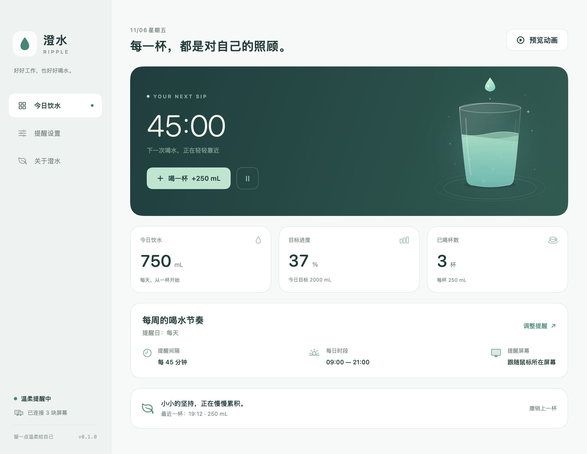
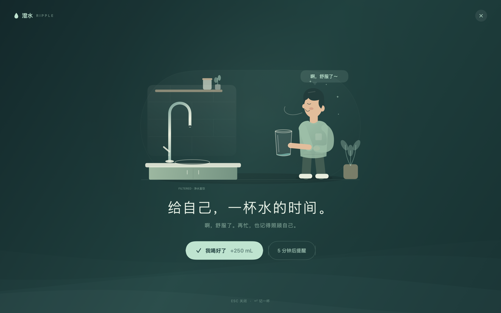
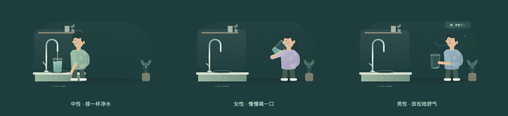

# 澄水 · Ripple

**给忙碌留一口水，给自己留一点温柔。**

一款为 macOS 打造的轻量喝水提醒应用。自定义提醒间隔与每日时段，在鼠标所在屏幕播放温柔的全屏矢量动画，喝一杯后继续专注。

[English](README.en.md) · [开发指南](docs/DEVELOPMENT.md) · [架构说明](docs/ARCHITECTURE.md) · [贡献指南](CONTRIBUTING.md) · [MIT License](LICENSE)



## 功能

- **自己的节奏**：1–240 分钟提醒间隔，15 / 30 / 45 / 60 / 90 分钟快捷选择。
- **安静时段**：设置开始、结束时间；支持跨午夜，起止相同表示全天提醒。
- **精美矢量动画**：主界面保留水滴、玻璃杯与涟漪；全屏呈现开放式厨房直饮净水龙头接水、人物举杯喝水与满足舒气的完整场景，Retina 和大屏无损缩放。
- **人物可选**：中性、女性、男性三种形象，默认中性；选择会保存在本机。
- **动作音效**：接水、咕嘟喝水与轻轻舒气的合成音效跟随动画，可独立关闭；多屏共用一份声音。
- **多屏感知**：默认只在鼠标所在屏幕提醒，也可选所有屏幕。找不到鼠标所属屏幕时自动回退到全部屏幕。
- **温柔退场**：确认喝水、延后 5 分钟、Esc 退出，或在 15 / 30 / 60 秒后自动关闭。
- **喝完撒花**：确认或识别完成后先收起全屏提醒，再在原目标屏幕上播放 3 秒庆典式全屏矢量撒花，彩纸、彩带与星形纸片从两侧喷出、从上方飘落；透明浮层不拦截鼠标，减少动态效果时显示静态完成提示。
- **可选摄像头检测（实验性）**：使用 Apple Vision 定位并记住嘴部，累计 1.2 秒有效杯具线索后自动完成；较弱线索可结合手部位置慢速确认，遮脸或短暂漏检不会清掉进度。开启强制检测后不接受手动确认或自动退场。
- **菜单栏常驻**：关闭主窗口后继续提醒，可随时暂停、记录饮水、打开设置或退出。
- **饮水记录**：自定义每杯容量与每日目标，统计当日饮水，支持撤销上一杯。
- **照顾休息**：锁屏、休眠或切换用户时暂停，恢复后重新计时，不追补错过的提醒。
- **无障碍**：支持键盘操作；跟随系统「减少动态效果」设置，呈现静态矢量画面。
- **完全离线**：无账号、无追踪、无广告，设置与记录保存在本机；支持可选登录启动。



动画使用 SwiftUI 路径与时间线实现，具有类似 Lottie 的矢量缩放与逐帧动效体验。项目没有第三方运行时依赖：主界面见 [WaterScene.swift](Ripple/Animation/WaterScene.swift)，全屏场景见 [DrinkingRitualScene.swift](Ripple/Animation/DrinkingRitualScene.swift)。音效由 [原生合成脚本](scripts/make_sounds.py) 离线生成，不包含真人录音或下载的素材。



## 在 Mac 上开发

需要 **macOS 14 或更新版本、Xcode 16 或更新版本**。当前版本在 Apple Silicon、macOS 26.5.1、Xcode 26.3 上构建并进行界面验证。

1. 下载或克隆仓库。
2. 打开 `Ripple.xcodeproj`。
3. 选择 **Ripple → My Mac**，按 **⌘R**。

工程和图标已纳入版本管理，直接打开即可。默认使用本地 ad-hoc 签名，在自己的 Mac 上开发无需先配置开发者团队。若 Xcode 提示工具链未选择，先完成 Xcode 首次启动，并在 Settings → Locations 中选择 Command Line Tools。

也可以使用命令行：

```bash
./scripts/build.sh --run
./scripts/test.sh
```

编译产物：`build/Build/Products/Debug/Ripple.app`。

## 使用

1. 在「提醒设置」中设置间隔与起止时间；修改后自动保存，重新计算下一次提醒。人物、音效和屏幕选择也在这里，调整这些偏好不会重置倒计时。
2. 点击右上角「预览动画」，立即查看当前多屏设置的效果。**预览不改变提醒时间，也不计入饮水记录**。
3. 正式提醒中点击「我喝好了」或按 Return，记录一杯饮水；选择「5 分钟后提醒」可稍后再喝。
4. 关闭主窗口后，从菜单栏的小水滴重新打开；选择「退出澄水」才会停止应用。

| 操作 | 快捷键 |
| --- | --- |
| 主界面记一杯 | ⌘D |
| 主界面预览动画 | ⌘P |
| 提醒中确认喝水 / 完成预览 | Return |
| 关闭提醒 | Esc |
| 退出应用 | ⌘Q |

这些快捷键在澄水界面或提醒获得键盘焦点时生效。应用不注册系统全局快捷键。

### 摄像头强制检测

在「提醒设置」开启「强制检测喝水」。首次使用会询问摄像头授权；先露出面部定位一次，看到「嘴部位置已记住」后正常喝水即可。杯子挡住脸时仍会检查最后记住的位置，累计 1.2 秒有效杯具线索后自动完成，并按预设容量记录一杯，**不要求露出嘴巴或放下杯子**。短暂漏检只暂停进度，不回退；退出或重试会重新定位。

针对纸杯 / 无柄杯，分别检查杯身、杯口和倾斜杯身。多个范围提供较弱杯具线索时，结合嘴边手部位置以较慢速度累计确认；仅有手不会通过。系统没有单独的纸杯模型，纸杯仍使用通用 `cup` 类别判断，实际效果需要在你的杯子与光线下复测。

建议先点「测试摄像头识别（不记水）」检查当前光线、摄像头角度与杯子。普通「预览动画」不启用摄像头。强制模式关闭手动确认、回车记水、延后与自动退场；识别失败可点击右上角退出并确认，或长按 Esc 2 秒紧急退出，本次不记水。锁屏、休眠或屏幕变化也会结束当前检测。

这项功能识别的是**嘴边出现杯具**，无法确认液体是否入口、是否吞咽，也不测量实际饮水量。画面仅在本机内存处理，不录像、不保存、不上传；结束提醒后停止摄像头。当前版本默认关闭，识别准确率需要在实际设备上验证。详见 [摄像头识别说明](docs/CAMERA_VERIFICATION.md)。

[查看识别界面示意](docs/images/camera-verification.png) · [测试模式的线索分数](docs/images/camera-diagnostics.png)（离线渲染与示例分数，不含真实摄像头画面）。测试模式显示杯身 / 杯口 / 倾斜区域分数和分类名称，普通正式提醒不显示这些调试数值。

### 提醒时间规则

默认时段为 **09:00–21:00**，间隔 **45 分钟**。时段内启动应用时，等一个完整间隔再提醒；时段外启动时，下次在开始时间提醒。结束时间不包含在提醒时段内。

例如：20:30 启动，间隔 45 分钟，结束时间 21:00，则下次提醒为次日 09:00。跨午夜如 22:00–02:00 同样适用。延后 5 分钟仍遵守每日时段。关闭或自动退场不会记录饮水，也不会立刻重复提醒。

登录启动需先将应用放到「应用程序」文件夹，再打开设置中的「登录时打开」。如系统要求允许，请在「系统设置 → 通用 → 登录项」中完成。

## 项目结构

```text
Ripple/                    macOS 应用
  App/                     生命周期、状态、计时与持久化
  Animation/               原生矢量动画
  Reminder/                多屏浮层与全屏提醒界面
  Views/                   主界面、设置与设计样式
  Resources/               应用图标
Sources/RippleCore/        纯逻辑 Swift Package：时段计算、屏幕路由、数据模型
Tests/RippleCoreTests/     时间边界与屏幕坐标测试
Ripple.xcodeproj/          可直接打开的 Xcode 工程与共享 Scheme
scripts/                   构建、测试、工程生成、图标及界面图导出
docs/                      开发、架构、隐私、验证与发布说明
```

## 验证与限制

核心逻辑测试覆盖日间与跨午夜时段、边界、夏令时、延后提醒、负坐标外接屏、上下排列屏幕及回退策略。当前测试与界面检查记录见 [VALIDATION.md](docs/VALIDATION.md)。

应用必须保持运行才能提醒；退出或关机时不运行。全屏浮层通过 macOS 公开窗口 API 呈现。系统登录 / 安全界面等受系统保护的画面不能保证被覆盖；多个 Space、独占全屏与 Stage Manager 的行为需要在目标配置上验证。屏幕连接变化时会关闭当前提醒，下一次提醒重新获取屏幕信息。

当前界面语言为简体中文。Intel Mac、其他 macOS 版本及开发者签名发布尚需各自验证。目标饮水量为个人可调记录项，应用不会推算健康建议。

## 隐私与开源

详见 [隐私说明](docs/PRIVACY.md)。项目使用 [MIT 许可证](LICENSE)，欢迎提交 Issue 和 Pull Request；请先阅读 [贡献指南](CONTRIBUTING.md)。

首次发布 GitHub 的本地操作步骤，以及 Developer ID 签名与公证注意事项见 [发布指南](docs/RELEASING.md)。
