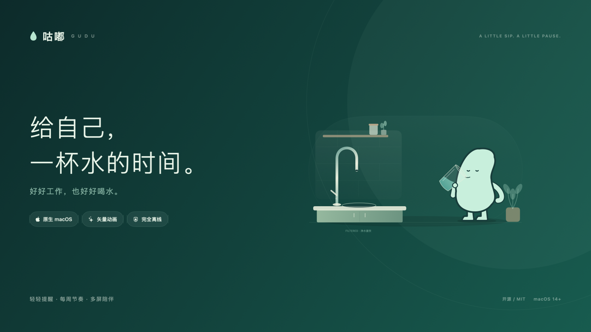
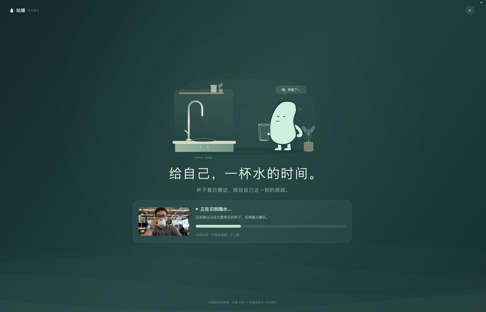

# 咕嘟 · Gudu 宣传素材

给自己，一杯水的时间。

实机截图由维护者提供并同意用于本项目展示。仅左上品牌区使用维护者补充的原生截图更新为「咕嘟 · GUDU」，人物与识别区域保持原截图。此图为实际使用示例，不能代表所有杯子与光线下的识别准确率。

封面由实际矢量场景离线生成；动画来自项目自身的 15 秒动作。设置、调试分数、占位和手动回退界面的开发预览不放入宣传页。

代码、脚本与原创矢量资源采用仓库 MIT License。实机图为维护者提供的展示素材。

仓库描述：**咕嘟 · Gudu — 原生 macOS 喝水提醒，矢量动画、多屏适配、每周节奏与本机摄像头识别。**

建议 topics：`macos`、`swiftui`、`water-reminder`、`menu-bar-app`、`vector-animation`、`vision`、`offline-first`。
